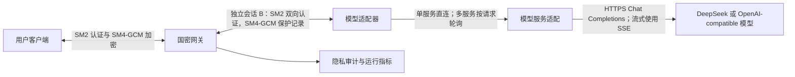
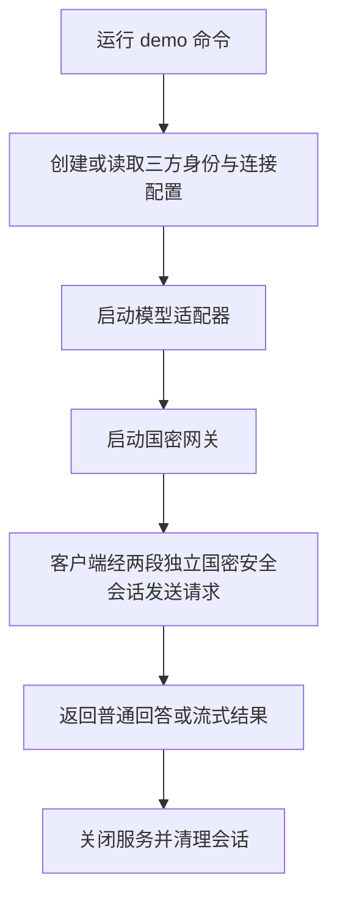
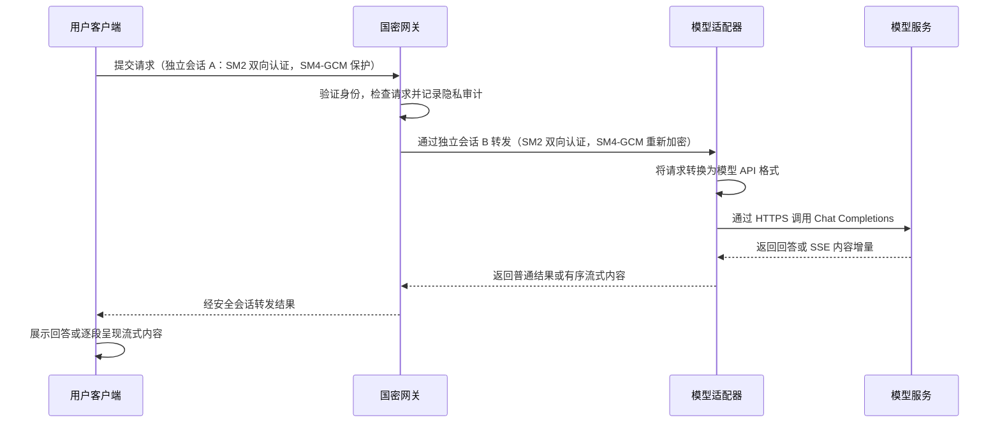

# 国密大模型推理安全网关

用户客户端通过国密网关连接模型适配器 adapter，由 adapter 调用配置的 DeepSeek 或 OpenAI-compatible 模型服务。客户端至网关、网关至 adapter 分别建立独立的 v2 国密安全会话：SM2 双向认证与密钥传送，SM4-GCM 保护请求和响应；adapter 至模型服务使用 HTTPS。



网关到模型适配器使用项目专用的 v2 国密安全会话，和客户端到网关的会话相互独立。双方先用预置 SM2 身份密钥完成双向认证，再通过 SM2 加密传送会话密钥材料，并用 HMAC-SM3 确认握手；会话建立后，请求和响应记录由 SM4-GCM 加密并校验，严格序号用于拒绝重放。两段链路使用不同的会话密钥、会话标识和序号：网关验证收到的请求后，在另一条安全会话中重新加密转发；响应也经过验证后再沿客户端链路返回。握手 v2 还支持基于 HMAC-SM3 的会话恢复，以及网关到适配器的安全连接池复用。

适配器把请求转换为模型服务支持的格式，通过 HTTPS 调用 DeepSeek 或 OpenAI-compatible 服务；普通回答或 SSE 流式内容沿原路径返回。网关同时执行资源限制、隐私审计和运行指标采集。适配器最多可配置 16 个模型服务，多服务时按请求轮询；各服务需提供相同的请求模型名。国密安全会话保护范围止于模型适配器，适配器到模型服务由 HTTPS 保护。

握手 v2 支持 Windows/Linux 加密保存恢复秘密、30 分钟内跨连接恢复以及网关上游独占连接池。新演示配置默认启用；已有三端须同步升级，启用、撤销和安全边界见[会话恢复说明](docs/session_resumption.md)。

## 快速开始

Windows（PowerShell）：

```powershell
powershell -NoProfile -ExecutionPolicy Bypass -File scripts/bootstrap.ps1
$env:DEEPSEEK_API_KEY = '<你的 DeepSeek API Key>'
.\.venv\Scripts\guomi-gateway.exe demo --prompt "你好"
.\.venv\Scripts\guomi-gateway.exe demo --prompt "你好" --stream
```

Linux（Bash）：

```bash
bash scripts/bootstrap.sh
export DEEPSEEK_API_KEY='<你的 DeepSeek API Key>'
.venv/bin/guomi-gateway demo --prompt '你好'
```

Linux 启动前设置 [原生库加载路径](docs/protocol.md#原生环境)。初始化脚本安装固定 Python、uv 和锁定依赖，构建并校验 GmSSL；首次运行需要联网、CMake 和 C 编译器。

默认模型为 `deepseek-flash`，关闭思考模式。`--model` 可指定模型，`--max-output-tokens` 为真实输出 token 上限，默认 512。响应以 UTC 时间戳和请求 UUID 的 JSON 行开头，随后为模型回答。`--quiet` 放在子命令前可隐藏过程日志。

也可在命令执行目录创建 `.env`，填写服务配置所引用的 API Key 环境变量，格式见 [环境与凭据](docs/usage.md#环境与凭据)。adapter、demo、infer、init-demo 和 webui 自动加载该文件，已有进程环境变量优先；服务地址和凭据变量名保存在 adapter JSON 中，WebUI 可编辑多服务轮询配置。

`demo` 首次生成本地身份和配置，启动 adapter 与网关，发送请求后关闭服务；再次运行复用配置。已有旧配置先按 [迁移说明](docs/deployment.md#从模拟服务迁移) 更新。

## 独立程序与直接推理

Windows 双击根目录 `start.cmd`，自动初始化本地身份、启动三角色 WebUI 及 adapter／网关业务服务，并打开三个浏览器页面。先完成 bootstrap，并在根目录 `.env` 配置模型凭据。在启动窗口按 Ctrl+C 统一停止本次启动的服务。端口设置与命令用法见 [一键启动](docs/webui.md#一键启动)。

三个角色各有本地中文 WebUI。先初始化身份，再在各角色的终端运行：

```powershell
.\.venv\Scripts\guomi-gateway.exe webui --role client
.\.venv\Scripts\guomi-gateway.exe webui --role gateway
.\.venv\Scripts\guomi-gateway.exe webui --role adapter
```

本机浏览器分别打开 `http://127.0.0.1:18080`、`:18081`、`:18082`。页面加载现有身份、保存连接地址，启动 adapter 与网关后，在客户端执行普通或流式推理。UI 启动不自动启动业务服务。局域网实验在每台角色主机本地打开 UI，角色之间继续使用国密协议；浏览器回环段使用 HTTP。详细步骤见 [WebUI 使用说明](docs/webui.md)。

```powershell
.\.venv\Scripts\guomi-gateway.exe init-demo
# 终端 1，设置 DEEPSEEK_API_KEY 后启动
.\.venv\Scripts\guomi-gateway.exe adapter
# 终端 2
.\.venv\Scripts\guomi-gateway.exe gateway
# 终端 3
.\.venv\Scripts\guomi-gateway.exe client --prompt "你好" --stream
```

`infer --prompt "你好"` 直接调用 provider。三程序启动及停止、检索片段和文件输入见 [使用说明](docs/usage.md)。





## 文档与源码

当前版本测试：541 项回归通过、6 项平台相关跳过；国密与 TLS 均启用恢复和连接池的 64 档负载共完成 1,371,209 次成功请求，0 次业务失败。测试使用本地模型替身，结果、范围与未验证项见[测试报告](docs/integration_report.md)。

- [题目要求与项目实现说明](docs/requirements_solution.md)：五项要求的实现机制、源码、测试证据及性能对照。
- [实现方案](docs/implementation_plan.md)：架构、安全边界、开发职责与验收。
- [公共接口](docs/interfaces.md)：契约 2.0、adapter 和 provider 扩展接口。
- [配置说明](docs/configuration.md)：信任、资源限额和多模型服务配置。
- [使用说明](docs/usage.md)：演示、独立运行及编程接口。
- [三角色 WebUI](docs/webui.md)：页面操作、局域网部署、安全边界与本地控制接口。
- [部署与迁移](docs/deployment.md)：旧角色配置迁移、凭据和回滚。
- [安全协议](docs/protocol.md)：国密记录与原生环境。
- [开发指南](docs/developer_guide.md)、[依赖管理](docs/dependencies.md)、[测试规范](docs/testing.md)。
- [测试报告](docs/integration_report.md)：当前功能、安全、恢复与连接池、TLS 性能对比及未验证项。
- [测试总览](docs/testing-dashboard.html)、[性能明细](docs/tls_baseline_results.md)与[测量方法](docs/performance.md)：分类结果、全部负载档位和复现步骤。
- [Agent 入口](AGENT.md)：工程规范。

源码位于 `src/gateway/`：`client/` 为用户业务客户端，`server/` 为网关，`adapter/server.py` 为安全模型适配器，`adapter/provider.py` 定义供应商接口，`adapter/deepseek.py` 调用 SDK，`runtime.py` 与 `cli.py` 管理配置和生命周期。密码与安全会话位于 `crypto/`、`protocol/`、`session/`。确定性业务替身仅位于 `test/`。
