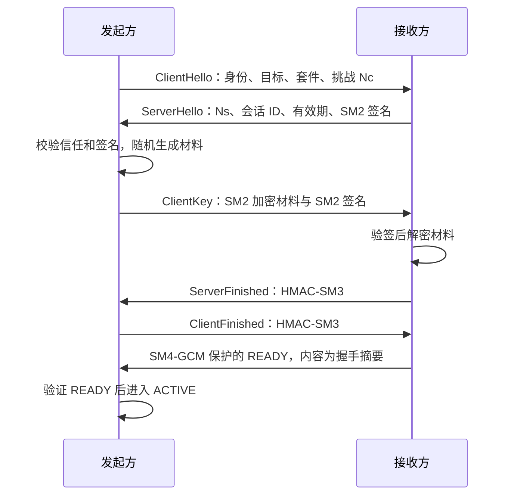

# 题目要求与项目实现说明

整理日期：2026-10-14。源码核对基准：`3ec791ad138410bf229cbf1d81388bc03fd85df1`。本说明按 [原始需求](offical_request.md) 的五项要求展开，说明实现机制、源码位置、测试方法和证据范围。

当前运行链路为客户端 → 国密网关 → 模型适配器 adapter → DeepSeek。前两段分别建立独立的国密会话，adapter 调用模型使用 HTTPS。本地自动化测试和性能实验使用 `test/` 内的模型替身；真实模型调用记录见 [整合报告](integration_report.md#deepseek-真实三进程验证)。

| 要求 | 本项目的解决方式 | 当前证据范围 |
| --- | --- | --- |
| 1. 身份认证、密钥保护、业务保密与完整性 | 预置 SM2 公钥、双向签名、SM2 加密会话材料、SM4-GCM 记录保护 | 真实 GmSSL 单链路及双链路测试；采用公钥信任方案 |
| 2. 建立、传输、关闭与异常拒绝 | 握手和密钥确认、认证 READY、严格序号、认证关闭、失败清理 | 篡改、重放、跨会话、关闭及取消回归 |
| 3. 密钥全生命周期、配置和日志 | 安全随机生成、内存缓冲区、重新握手轮换、覆盖释放、严格配置与白名单日志 | 生命周期和日志测试；内存清零存在 Python/原生副本边界 |
| 4. 自动化测试与结果输出 | pytest、合成输入、故障注入、JSON 和 JUnit 报告 | 当前 adapter 本地回归已有记录，详细输入规则由测试源码定义 |
| 5. 性能实验及公开方案对照 | 三进程统一基准、两段各 100 次握手、两种载荷、TLS 1.3 对照 | 2026-10-05 历史版本完成正式矩阵；当前 adapter 版本需重新完成正式矩阵 |

## 1. 身份认证、会话密钥保护和业务报文保护

### 1.1 使用 SM2 证书或预置公钥完成通信实体身份认证

项目选择预置公钥路线。各角色的 JSON 配置保存受信任对端的身份名称、角色、签名公钥、加密公钥、启用状态和有效截止时间。运行层将这些配置构造成 `LocalIdentity` 与 `TrustRecord`，交给 `SecuritySessionManager`；当前运行身份的密钥版本固定为 1，核心接口与握手编码仍校验版本。业务请求不能指定新的信任公钥或上游地址。

握手时，接收方检查目标是否为本机身份，双方按本地信任表验证对端身份。只授权 client→gateway 和 gateway→adapter 两种角色组合。`ServerHello` 由接收方签名，`ClientKey` 由发起方签名；验签使用预置签名公钥，并将对端身份名称作为 SM2 signer ID。签名输入绑定身份、角色、版本、挑战随机数及握手参数，防止将合法签名移到其他握手上下文。

信任检查包括 `enabled` 和有效期，握手公开为 ACTIVE 前再次检查，防止握手期间信任过期。核心 `TrustRecord` 支持 `not_before` 与 `expires_at`，当前运行 JSON 加载器开放 `enabled` 与 `expires_at`，未开放 `not_before` 配置。

实现位置：[身份与握手](../src/gateway/session/core.py) 的 `LocalIdentity`、`TrustRecord`、`_trust()`、`_verify()`、`_initiate()`、`_accept()`；[运行配置加载](../src/gateway/runtime.py) 的 `load_runtime()`；[SM2 后端](../src/gateway/crypto/backend.py) 的 `sign_sm2()`、`verify_sm2()`。

当前没有实现 SM2 X.509 证书链、CRL 或 OCSP 校验。“身份失效”在本方案中通过禁用或过期的公钥信任记录表达，不应称为已完成 SM2 证书管理。

### 1.2 使用 SM2 保护会话密钥

双方长期签名密钥和加密密钥分开使用。发起方验证接收方签名后，通过 GmSSL 的安全随机源生成 72 字节握手材料，用接收方预置 SM2 加密公钥加密，并对密文及握手摘要签名。接收方先验证签名，再用自己的解密私钥解开材料。

材料布局为：发起方向 SM4 密钥 16 字节、接收方向 SM4 密钥 16 字节、两方向 nonce 前缀各 4 字节、Finished 确认密钥 32 字节。双方使用不同域标签的 HMAC-SM3，对完整握手摘要作 Finished 确认，确认双方拿到同一份材料。握手完成只保留前 40 字节记录保护材料，覆盖临时材料缓冲区。

实现位置：[握手材料交换](../src/gateway/session/core.py) 的 `_initiate()`、`_accept()`、`_mac()`、`handshake()`；[密码后端](../src/gateway/crypto/backend.py) 的 `random_bytes()`、`encrypt_sm2()`、`decrypt_sm2()`、`hmac_sm3()`。

这是 SM2 密钥传送方案，没有临时密钥协商提供的前向保密：长期解密私钥泄露后，已捕获的握手密文可能被解开。新会话使用新随机材料和新会话标识，但这本身不能消除该限制。

### 1.3 使用 SM4 保护提示词、检索片段和模型输出

客户端先将提示词和检索片段编码为业务载荷，再按记录限额分片，每条记录使用 SM4-GCM 加密。普通模型输出经响应编码后加密发送；流式输出按 UTF-8 字节分片，每个分片也独立受保护。

网关接收、验证并解密入站记录后，通过独立上游会话重新加密转发；返回方向同样验证后重新加密。两段不共用会话 ID 或密钥，因此不会直接将第一段密文作为第二段记录使用。

实现位置：[业务编码](../src/gateway/codec.py)、[分片与组装](../src/gateway/framing.py)、[客户端](../src/gateway/client/inference_client.py)、[网关转发](../src/gateway/server/relay.py)、[adapter 响应](../src/gateway/adapter/server.py)、[SM4-GCM 后端](../src/gateway/crypto/backend.py)。

保护范围止于 adapter。网关和 adapter 的业务处理内存会出现明文，adapter→DeepSeek 由 HTTPS 保护；当前方案不提供绕过网关解密的端到端密文推理，也不隐藏报文长度和通信时序。

### 1.4 校验报文完整性

业务记录选择 SM4 认证加密模式，即 SM4-GCM，使用 128 位密钥、96 位 nonce 和 128 位认证标签。完整记录头作为附加认证数据 AAD，载荷作为密文；修改头部、密文或标签都会被记录上下文检查或 GCM 校验拒绝。HMAC-SM3 用于握手 Finished，业务记录完整性由 GCM 标签承担。

解密中的 `update()` 输出暂存在可覆盖缓冲区，只有 `finish()` 校验标签成功才返回明文；失败映射为 `AuthenticationError`，暂存缓冲区在 `finally` 中覆盖。该安排避免未经认证的解密结果流入业务层。

实现位置：[记录收发](../src/gateway/session/core.py) 的 `_send()`、`_receive()`；[原生认证解密](../src/gateway/crypto/backend.py) 的 `open_sm4_gcm()`。算法正确性测试包括 [SM4-GCM 向量与 SM2 测试](../test/unit/security_core/test_backend.py)。

## 2. 会话建立、数据传输、关闭和异常处理

### 2.1 会话建立流程

两段链路执行相同流程，第二段由网关作为发起方。握手完成之前不能调用业务收发接口。



接收方完成 READY 写入后进入 ACTIVE。握手超时、签名失败、Finished 不一致、容量不足等路径关闭连接、释放会话 ID 和待建立名额，不向调用者返回可用会话。实现见 [安全会话](../src/gateway/session/core.py) 的 `handshake()`、`open()`、`accept()`。

### 2.2 数据传输与每条业务报文的必要信息

线帧由 4 字节长度前缀、52 字节记录头、密文和 16 字节 GCM 标签组成。接收方先检查长度上限，再读取内容，防止按攻击者指定长度分配无界数据。

| 记录头字段 | 长度 | 用途 |
| --- | --- | --- |
| 协议版本、记录类型 | 各 1 字节 | 区分请求、响应、控制记录并拒绝非法格式 |
| 会话 ID | 16 字节 | 绑定当前会话，拒绝跨会话替换 |
| 方向 | 1 字节 | 区分发起→接收和接收→发起，拒绝反射 |
| 序列号 | 8 字节 | 严格顺序接收，识别重复和乱序 |
| 请求 UUID | 16 字节 | 关联请求、响应与取消 |
| 分片号、结束标志 | 4 字节、1 字节 | 校验分片连续性和消息完整结束 |
| 密文与标签总长度 | 4 字节 | 校验实际记录长度 |

协议使用序列号满足新鲜性检查，每条安全记录不额外携带时间戳。响应展示中的 UTC 时间是业务元数据，不代替记录序号验证。记录头编码见 [协议模块](../src/gateway/protocol/__init__.py)，完整线格式见 [安全协议](protocol.md#规范线格式)。

### 2.3 识别篡改与重复报文

每个方向分别维护发送和接收序号，nonce 为 `4 字节方向前缀 || 8 字节序号`。发送锁覆盖序号分配、加密和写入；序号在加密前消耗，失败不回退，防止同一方向同一密钥复用 nonce。接收方要求会话 ID、方向及序号与当前上下文完全一致，GCM 校验和控制语义检查成功后才推进接收计数。

已接收序号再次出现会被拒绝；旧会话报文注入新会话也因 ID、密钥不同而失败。业务层另检查请求 UUID、连续分片和结束标志，避免将错误响应或截断数据当成完整结果。

实现位置：[安全会话](../src/gateway/session/core.py) 的 `_parameters()`、`_send()`、`_receive()`；[业务边界](../src/gateway/framing.py) 和 [网关](../src/gateway/server/relay.py)。这属于记录重放防护，没有实现跨连接的业务请求持久化去重；合法客户端重新提交同一业务内容仍可能再次执行。

### 2.4 会话关闭流程

`close()` 将会话置为 DRAINING，发送认证 CLOSE，并在限定时间内等待认证 CLOSE_ACK 或处理同时关闭。对端 `recv()` 收到 CLOSE 后发送 ACK、清理并抛出 `SessionClosedError`。关闭超时、断连或确认失败仍执行最终清理，不无限等待；重复关闭可安全返回。

停机时 manager 停止新会话准入，取消并等待握手任务，关闭活跃会话，最后等待已启动的原生密码任务完成。实现见 [关闭与停机](../src/gateway/session/core.py) 的 `recv()`、`close()`、`SecuritySessionManager.close()`。

### 2.5 认证或校验失败不得继续处理业务数据

网络入口只能从成功认证的会话接收 `VerifiedRecord`。握手失败没有 ACTIVE 会话；记录校验失败不返回明文，`recv()` 关闭当前会话并清理密钥。网关只转发已验证载荷；adapter 在完整组装、解码并核对 UUID 后才调用 provider。

失败会阻止该记录及后续业务继续处理。已成功验证、已经执行的较早请求无法因后来发现的重放而撤销，因此重放测试断言模型调用次数最多一次。两段篡改测试则断言 provider 调用次数为零。测试见 [双链路异常验证](../test/integration/test_topology.py)。

## 3. 会话密钥生命周期、配置与日志

### 3.1 生成

会话材料由 `GmSSLBackend.random_bytes()` 调用原生 `rand_bytes` 生成，检查原生返回值，失败即终止握手；不用时间戳或普通伪随机数充当密钥。每次完整握手重新生成材料，两段链路分别握手。随机源错误测试见 [后端测试](../test/unit/security_core/test_backend.py) 的 `test_random_failure_is_checked()`。

### 3.2 存储

会话记录材料仅存于 `SecuritySession._keys` 的 `bytearray`，不写入文件或配置。长期 SM2 私钥使用口令加密 PKCS#8 DER 文件，启动时解锁导入；`LocalIdentity` 的私钥字段不进入对象 repr。演示初始化为私钥和口令文件设置 POSIX 权限或 Windows 目录 ACL。

实现位置：[会话存储](../src/gateway/session/core.py)、[私钥导入导出](../src/gateway/crypto/backend.py)、[身份初始化](../src/gateway/runtime.py) 的 `prepare_demo()`。演示口令与私钥位于同一受限目录；当前没有 HSM、独立密钥托管或磁盘加密管理，不能将该原型等同于生产密钥存储方案。

### 3.3 使用

按报文方向选择不同的 SM4 密钥与 nonce 前缀，严格序号确保该方向的 nonce 不重复。每次发送、接收及密码操作完成后检查会话期限，并限制每方向记录数和明文字节总量。达到期限或预算即拒绝后续使用。具体实现为 `_parameters()`、`_check()`、`_send()`、`_receive()`。

### 3.4 更新

进入绝对寿命的提前轮换区间后，会话进入 DRAINING，只允许已登记请求收尾，不接纳新请求。`SecuritySessionManager.rotate(outbound_session)` 通过完整新握手产生独立会话，再将旧会话排空；新旧会话 ID、密钥和计数分别维护。轮换失败不延长旧会话寿命，到达硬截止仍关闭。

核心提供轮换 API 和定时 DRAINING，但当前客户端没有自动调用该 API 并切换新会话的循环，需要调用方管理替换；网关目前每个业务请求都新建、用完关闭上游会话，没有上游连接池。测试见 [会话测试](../test/unit/security_core/test_session.py) 的 `test_rotation_fresh_keys_and_existing_request_drains()`、`test_rotation_failure_keeps_original_deadline()`，以及 [双链路轮换业务](../test/integration/test_topology.py) 的 `test_rotation_then_business_uses_new_session()`。

### 3.5 销毁

正常关闭、认证失败、记录失败、超时、取消及停机均调用 `_abort()`，先用零覆盖会话持有的可变密钥缓冲区，再清空缓冲区，移除会话、会话 ID 和在途请求登记。握手临时材料和未认证解密暂存也覆盖后释放。定时任务确保无业务调用时过期会话仍关闭。

这些措施销毁本实现明确持有的可变缓冲区；Python 临时 `bytes`、ctypes 与原生库上下文可能保留副本，不能保证进程内所有副本物理清零。测试中的“密钥释放”判定为会话 `_keys` 清空和资源登记移除，不证明内存取证不可恢复。

### 3.6 算法参数、有效期和日志级别配置

共享 TOML 通过 `load_config()` 严格校验，角色 JSON 通过 `load_runtime()` 加载信任及本地身份。配置启动时读取，修改后重启生效。以下为主要字段，完整可运行模式见 [配置说明](configuration.md)。

| 配置位置 | 字段 | 默认值或约束 |
| --- | --- | --- |
| `[gateway]` | `suite`、`tag_bytes` | 仅支持 `SM2-SM4-GCM-SM3-v1`、16 字节标签 |
| `[session]` | `handshake_timeout_seconds` | 5 秒 |
| `[session]` | `absolute_lifetime_seconds`、`idle_timeout_seconds` | 1800 秒、300 秒 |
| `[session]` | `rotate_before_seconds`、`max_records_per_direction` | 60 秒、1048576 条 |
| `[limits]` | `max_plaintext_bytes_per_direction` | 1073741824 字节 |
| `[limits]` | `max_record_plaintext_bytes` | 默认 65536 字节，可降低 |
| `[gateway]` | `log_level` | 默认 INFO，支持 DEBUG/INFO/WARNING/ERROR/CRITICAL |
| 角色 JSON 的 `trust` | `enabled`、`expires_at` | 控制预置身份可用性与有效期 |

算法套件和标签长度虽然是配置字段，当前只允许上述安全组合；SM4 密钥长度和 nonce 长度固定于协议，不能任意调参。非法套件、短标签、未知字段、错误类型和矛盾的时间/预算配置均拒绝启动。见 [配置实现](../src/gateway/config.py) 与 [运行加载器](../src/gateway/runtime.py)。

### 3.7 日志不记录密钥、完整提示词或完整模型输出

运行日志采用固定事件和元数据白名单，仅保留合法 UUID、耗时、字节数、固定角色及结果等。密钥、口令、令牌、提示词、检索片段、输出、异常等字段脱敏；未知字段丢弃，不输出任意对象 repr 或异常栈。过滤在创建 LogRecord 前完成，各日志级别使用相同规则。

JSONL 审计单独逐字段构造，不序列化业务对象，网关另生成审计 UUID。审计队列有界并保留安全事件容量；写入故障或终结审计无法入队时阻止继续接纳业务。已完成业务的终结记录仍可能无法持久化，当前不提供业务与审计的原子提交。运行日志阈值不关闭安全审计。

实现位置：[运行日志](../src/gateway/logging.py)、[审计](../src/gateway/audit.py)、[网关审计处理](../src/gateway/server/relay.py)。[日志回归](../test/unit/gateway/test_logging.py) 检查各级别、异常、嵌套载荷和输出故障中没有合成敏感标记。业务回答通过 CLI stdout 展示属于用户输出；第三方自行写入的日志和绕过受控入口的 print 不受该模块保证。

## 4. 自动化测试、输入与判定输出

### 4.1 测试组织和执行

项目使用 pytest。`test/unit/security_core/` 验证真实原生密码与会话；`test/unit/gateway/` 验证转发、配置和日志；`test/integration/` 验证真实双国密链路及三个独立 CLI 进程。原生库缺失或校验失败时相关测试失败，不以跳过替代验证。测试使用运行时生成的密钥和合成业务文本。

从仓库根目录设置原生库并执行本地回归：

```powershell
$nativeManifest = Get-Content .tools/gmssl/manifest.json -Raw | ConvertFrom-Json
$env:GMSSL_LIBRARY = $nativeManifest.library
$env:GMSSL_SHA256 = $nativeManifest.sha256
$env:PATH = (Split-Path -Parent $nativeManifest.library) + ';' + $env:PATH
.\.tools\uv\uv.exe run --locked pytest test/ -m "not e2e" --junitxml=artifacts/requirements-junit.xml
```

当前文档已有 2026-10-14 adapter 回归记录：388 项通过、5 项 Linux bootstrap 跳过、1 项外部 e2e 排除。该统计是已有验证记录，本次文档整理未重新运行回归。历史真实 DeepSeek 普通/流式成功调用也已有记录，但不能代替本地异常测试或持续稳定性验证，详见 [测试规范](testing.md) 与 [整合报告](integration_report.md)。

### 4.2 五类必测情况的步骤、输入和判定

| 情况与源码 | 测试步骤及输入 | 判定条件 |
| --- | --- | --- |
| 正常通信：`test_real_roundtrip_and_privacy`，位于 [双链路测试](../test/integration/test_topology.py) | 真实握手；构造 1024/16384/70000 字符 ASCII 提示词，含 `synthetic-private-marker`；加入 `synthetic-retrieval-marker`；分别请求普通/流式输出，捕获线帧并扫描审计 | 返回内容与测试 provider 一致；流式只有一个最终片；两段 ID 和密钥指纹不同；帧与审计不含合成明文标记；停机无残留 |
| 密文篡改：`test_tampering_never_delivers_plaintext`，位于 [安全会话测试](../test/unit/security_core/test_session.py)；`test_ciphertext_tampering_never_calls_inference`，位于双链路测试 | 安全核心对记录指定偏移翻转一位；双链路分别在客户端段或上游段翻转请求记录末尾一位；业务输入为 `synthetic` | 接收异常且不交付明文；核心接收计数不增长、密钥清空；双链路 provider 调用次数为 0 |
| 报文重放：`test_replay_and_wire_privacy`、`test_replay_never_executes_twice` | 核心发送并接收 `private-marker`，再注入捕获的完整帧；双链路重复发送 `synthetic` 请求的认证记录 | 核心第二次接收报认证错误；双链路调用次数最多 1，后续请求被拒绝 |
| 会话超时：`test_expiry_releases_keys`、`test_idle_timer_closes_without_api_call`、`test_expired_client_session_never_forwards` | 将单调测试时钟推进到空闲或绝对期限之后，再收发；另用 1 秒空闲策略验证无 API 调用时定时关闭 | 会话 CLOSED，密钥清空；过期客户端请求没有建立上游会话 |
| 公钥错误或身份失效：`test_trust_failures`、`test_trust_failure_blocks_business` | 用新生成且不匹配的合法签名公钥替换信任记录，或设 `expires_at=1`；双链路分别修改客户端或网关信任；核心另测禁用、角色和版本错误 | 握手/业务失败，无成功建立的上游会话；核心待建立计数、会话和 ID 释放 |

国密身份采用预置公钥，因此最后一类用错误公钥和过期信任覆盖题目“证书失效或公钥错误”分支，不将其当作 SM2 证书失效测试。公开 TLS 对照另外有缺失证书、错误证书与错误目标身份的真实拒绝测试，见 [TLS 测试](../test/benchmark/test_transport.py)。

### 4.3 输出测试步骤、输入数据和判定结果

安全核心通过 [报告夹具](../test/unit/security_core/conftest.py) 输出 `artifacts/security-core.json`；集成通过 [集成报告夹具](../test/integration/conftest.py) 输出 `artifacts/integration.json`；网关测试在 `.tools/gateway-test-report.json` 输出局部报告，JUnit 路径由命令指定。

JSON 字段包括 `case_id`、`steps`、`input_summary`、`mutation_position`、`expected`、`actual`、`duration_seconds`、`verdict`。输入由测试名称/参数摘要及源码中的固定生成规则共同标识；随机私钥、口令和完整业务内容不进入报告。JUnit 保存标准通过、失败、跳过及耗时结果。

现有报告已输出步骤、输入摘要和判定，但集成夹具的步骤是通用说明，未将每例完整输入字节逐条展开。上表和对应源码补充具体输入及故障动作；若提交材料要求每例独立报告包含完整非敏感输入或可直接复现的详细步骤，还需增强报告生成器，不能把当前摘要称为完整输入转储。

## 5. 性能实验与公开方案对比

### 5.1 同一软硬件环境和不少于 100 次会话建立

基准入口为 [测量工具](../test/benchmark/run.py)，客户端、网关和推理侧各一个独立进程，使用 IPv4 回环 TCP。国密与 TLS 复用业务编码、网关转发、普通/流式处理和即时回显 provider；每次业务都重新建立上游会话。正式数据中的两方案在同一主机和依赖环境下运行。

2026-10-05 正式环境为 Windows 11、AMD64 Family 25 Model 117、16 逻辑核、Python 3.12.11、OpenSSL 3.5.3、GmSSL 3.1.1/官方绑定 2.2.2。国密和 TLS 各覆盖审计开关两组，每组 A/B 两段各 100 次握手，总计 800 次，全部成功。每次独立记录 TCP、TCP 完成到认证 READY、总初始化时延；下表为总初始化均值。

| 方案 | 审计 | 客户端→网关，100 次均值 ms | 网关身份→推理侧，100 次均值 ms |
| --- | --- | --- | --- |
| 国密 | 关闭 | 16.188 | 16.319 |
| 国密 | 开启 | 21.002 | 25.621 |
| TLS 1.3 | 关闭 | 2.832 | 2.804 |
| TLS 1.3 | 开启 | 2.702 | 2.614 |

握手区间包含身份认证、调度与应用确认，不是纯算法耗时。B 段独立握手由负载进程使用网关身份发起，不是对实际网关线程的单独性能剖析。

### 5.2 1 KB 和 16 KB 载荷的数据传输

测试明确采用 1 KiB=1024 字节、16 KiB=16384 字节 ASCII 提示词，回显输出与提示词等长；编码和安全记录会增加额外字节。矩阵覆盖两方案 × 两种载荷 × 1/10/50/100 并发 × 普通/流式 × 审计开关，共 64 档。每档至少运行 30 秒并完成 1000 次成功业务，累计 440337 次成功、0 次失败。

下表统一取审计开启、10 并发、普通请求的历史代表档位。平均吞吐按完整测量墙钟上的成功交付双向业务字节计算，未包含安全头、标签及 TCP/IP 开销。

| 方案 | 提示词字节 | 平均双向吞吐 MiB/s | 三进程合计 CPU % | 矩阵同步峰值 RSS MiB |
| --- | --- | --- | --- | --- |
| 国密 | 1024 | 0.294 | 511.9 | 149.3 |
| TLS 1.3 | 1024 | 1.016 | 194.1 | 323.3 |
| 国密 | 16384 | 4.351 | 531.1 | 179.6 |
| TLS 1.3 | 16384 | 12.575 | 192.1 | 367.3 |

### 5.3 平均吞吐、CPU 和峰值内存的测量口径

平均双向吞吐 = `成功业务数 ×（提示词字节 + 回显输出字节）/ 实际墙钟秒数 / 2^20`。CPU = 三进程 user+system CPU 时间增量之和 / 同一区间墙钟 ×100%；100% 代表一个逻辑核，因此可能超过 100%。整机归一化占用需再除以 16 个逻辑核。

工具每 100 ms 采样三进程 RSS，峰值为同次采样的三个 RSS 之和的最大值。采样存在短时偏移并可能漏掉瞬时峰值。负载进程包含统计和采样开销，原矩阵还累计保留前序原始数据，因此上表 RSS 不能直接用来判断两方案内存优势。

项目另外完成四次全新三进程的代表档 RSS 复测，同样为审计开启、10 并发、普通请求，每次达到 30 秒和 1000 次请求预算：

| 方案 | 提示词字节 | 全新进程同步峰值 RSS MiB |
| --- | --- | --- |
| 国密 | 1024 | 126.8 |
| TLS 1.3 | 1024 | 144.7 |
| 国密 | 16384 | 129.3 |
| TLS 1.3 | 16384 | 148.6 |

四次复测仍包括当前档的测量开销，仅支持这些代表档位的比较。详细指标及原始数据哈希见 [性能结果](performance_results.md)，统计公式与限制见 [测量方法](performance.md#统计与证据)。

### 5.4 与公开安全通信方案的功能对比

项目选择公开 TLS 1.3 作为对照，通过 Python ssl/OpenSSL 实现真实双向证书认证。基线使用 P-256 证书及临时密钥协商，实际套件为 `TLS_AES_256_GCM_SHA384`，禁用票据并拒绝恢复会话，不使用 0-RTT。实现见 [基线传输](../test/benchmark/transport.py)。TLS 的认证、记录保护和临时密钥协商性质依据 [RFC 8446](https://www.rfc-editor.org/rfc/rfc8446.html#appendix-E)。

| 功能 | 本项目国密方案 | 本项目 TLS 1.3 对照 |
| --- | --- | --- |
| 通信实体认证 | 固定 SM2 双公钥与双向签名，角色/版本绑定 | 每角色独立 P-256 证书，双向验证及目标身份检查 |
| 会话材料建立 | 随机材料通过 SM2 长期公钥加密传送 | 临时 P-256 密钥协商 |
| 业务保护 | SM4-GCM，头部作为 AAD | TLS AES-256-GCM 记录保护 |
| 重放防护 | 会话 ID、方向、严格序号及 GCM 标签 | TLS 记录序号与 AEAD；测量适配器额外保留应用头 |
| 前向保密 | 当前没有 | 本次临时密钥协商基线具备 |
| 密钥期限、排空与轮换 | 核心实现绝对/空闲期限、预算和新握手轮换 API | 测量适配器未实现等价的全部应用策略；TLS 标准提供 KeyUpdate |
| 推理审计、限额与业务分片 | 网关、业务层实现 | 两方案复用同一网关与业务层 |

TLS 适配器用于基准，未实现国密核心所有应用生命周期策略，不能作为完整生产替代。共享审计和业务限额是网关层功能，不应据此说 TLS 本身缺少这些能力。

### 5.5 本方案的优势与不足

本方案的优势是明确使用 SM2/SM3/SM4，适合题目的国密算法路线；认证材料在本地固定信任表中管理，身份、角色、版本和目标地址集中校验；记录层保护请求、检索和输出，网关提供有界处理、隐私审计及本机指标。独立进程 RSS 复测中，国密代表档内存比该 TLS 基线低，但结论仅限此实现和档位。

不足主要是当前握手和吞吐性能落后于本机 TLS 基线：审计开启的 A 段平均握手约为 TLS 的 7.8 倍，10 并发普通请求的 1 KiB/16 KiB 吞吐分别约为 TLS 的 29%/35%，同时消耗更多 CPU。这些差异包含握手往返、ctypes/工作线程调用、每次上游重建会话及协议实现路径，不能归因于 SM4 算法本身。方案还缺少前向保密、证书链管理、自动客户端轮换及上游连接池；生产密钥托管和彻底内存清零也未解决。

### 5.6 证据来源、复现和当前版本待完成项

本次整理核对了本地 `artifacts/performance.json`：64 档、440337 次成功、800 次握手，SHA256 为 `01fac0892d1aba4a591d42a6b73678dee6e40c3c364fadbb74736948b15dfb61`，与既有性能报告一致；四份 RSS JSON 的哈希也与报告一致。本地产物在忽略目录，不随 Git 分发。

正式性能数据来自 2026-10-05 的 client→gateway→simulator 版本，来源基准 `6773d0fe9181edd1c495399cbe26344480bbde13`，测量工具由当轮新增实现。当前 adapter/provider 版本已有 2026-10-14 的短预算工具冒烟记录，但它不满足 100 次握手或完整负载矩阵条件。历史性能数字不能作为当前 adapter 版本、真实模型或跨主机部署的实测结果。

当前版本可用以下命令重新执行正式国密/TLS 矩阵并生成新报告，保留历史文件：

```powershell
.\.tools\uv\uv.exe run --locked python -m test.benchmark.run --manifest .tools/gmssl/manifest.json --modes gm tls --rounds 1 --handshakes 100 --requests 1000 --seconds 30 --output artifacts/adapter-performance-formal.json
.\.tools\uv\uv.exe run --locked python -m test.benchmark.report artifacts/adapter-performance-formal.json --markdown docs/adapter_performance_results.md --csv artifacts/adapter-performance-summary.csv --date 2026-10-14
```

工具保存逐次时延、环境、预算、CPU/RSS、失败、审计和停机证据；`acceptance_problems(..., formal=True)` 校验矩阵覆盖及最低预算。报告中的完整矩阵判定应通过，不能只以进程退出码或 `complete=true` 认定正式验收。

新实验应隔离后台负载，分别保持相同软硬件、审计和业务配置，独立进程复测内存，并按实际运行日期生成报告。历史实验只运行一轮，未固定 CPU 频率或证明后台负载隔离；当前版本正式性能重测、受控多轮稳定性及生产环境压力验证仍待完成。
